<!-- ================================================================= -->
<!--                    INDRESH SURESH — PROFILE README                -->
<!--          AESTHETIC: DARK FUTURISTIC DEVELOPER DASHBOARD / TERMINAL -->
<!-- ================================================================= -->

<div align="center">

<!-- LIVE ANIMATED TERMINAL BANNER -->
<a href="https://github.com/indresh404">
  
</a>

</div>

<br />

<!-- ================================================================= -->
<!--                     1. PROFILE HERO SECTION                       -->
<!-- ================================================================= -->

<table width="100%">
  <tr>
    <td width="73%" valign="top">
      <code style="color: #39D353;">&gt; ABOUT</code><br />
      <h2><b>Indresh Suresh</b></h2>
      <b>Full-Stack Engineer &bull; System Architect &bull; Co-Founder &amp; CTO @ GullyGig</b>
      <br /><br />
      Third-year B.Tech Computer Engineering student passionate about engineering scalable real-world digital architectures, autonomous systems, and hardware-software integration.<br /><br />
      As the <b>Co-Founder &amp; CTO of GullyGig</b>, I architect scalable web platforms, lead technical strategy, and build mission-critical products like <b>AgriVyaan</b>, <b>Swasthya AI</b>, and <b>HackNext</b>. Deeply committed to open-source governance and collaborative engineering.
      <br /><br />
      <b>📍 Mumbai, India</b> &nbsp;&bull;&nbsp; 
      <b>🎓 Computer Engineering</b> &nbsp;&bull;&nbsp; 
      <b>🐙 <a href="https://github.com/indresh404">@indresh404</a></b> &nbsp;&bull;&nbsp; 
      <b>💼 Co-Founder &amp; CTO</b> &nbsp;&bull;&nbsp; 
      <b>🌐 Open-Source Contributor</b>
    </td>
    <td width="27%" align="center" valign="middle">
      <a href="https://github.com/indresh404">
        
      </a>
      <br /><br />
      <code>[ IDENTITY VERIFIED ]</code><br />
      <sub><code>● SYSTEM STATUS: ACTIVE</code></sub>
    </td>
  </tr>
</table>

<br />

<!-- DYNAMIC REAL-TIME STATS ROW (PULLS LIVE DATA DIRECTLY FROM GITHUB) -->
<table width="100%">
  <tr>
    <td width="50%" align="center" valign="middle">
      <a href="https://github.com/indresh404">
        
      </a>
    </td>
    <td width="50%" align="center" valign="middle">
      <a href="https://github.com/indresh404">
        
      </a>
    </td>
  </tr>
</table>

<br />

<!-- COMPACT MOST USED LANGUAGES (CLEAN SCALED SIZE) -->
<div align="center">
  <a href="https://github.com/indresh404">
    
  </a>
</div>

<br />

<!-- ================================================================= -->
<!--               3. TOP FEATURED PROJECTS SECTION                    -->
<!-- ================================================================= -->

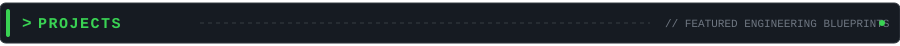

<br /><br />

<!-- TOP 4 PROJECTS: AGRIVYAAN, SWASTHYA AI, HACKNEXT, SYNDEO -->
<table width="100%">
  <tr>
    <!-- 1. AgriVyaan -->
    <td width="50%" align="center" valign="top">
      <a href="https://github.com/indresh404/AgriVyaan">
        
      </a>
      <p align="left">
        <b><a href="https://github.com/indresh404/AgriVyaan">AgriVyaan / AgriSwarm</a></b><br />
        <sub>Autonomous agricultural drone-based crop monitoring and targeted disease detection system with offline-first agricultural intelligence.</sub><br />
        <code>Flutter</code> &nbsp;<code>Python</code> &nbsp;<code>YOLO11n</code> &nbsp;<code>ArduPilot</code> &nbsp;<code>MAVLink</code> &nbsp;<code>Supabase</code>
      </p>
    </td>
    <!-- 2. Swasthya AI -->
    <td width="50%" align="center" valign="top">
      <a href="https://github.com/indresh404/Swasthya-AI">
        
      </a>
      <p align="left">
        <b><a href="https://github.com/indresh404/Swasthya-AI">Swasthya AI</a></b><br />
        <sub>Voice-first multilingual health platform powered by a Neo4j memory graph, connecting symptoms, family history, and recovery over time.</sub><br />
        <code>TypeScript</code> &nbsp;<code>Neo4j</code> &nbsp;<code>Sarvam AI</code> &nbsp;<code>FastAPI</code> &nbsp;<code>Render Workflows</code>
      </p>
    </td>
  </tr>
  <tr>
    <!-- 3. HackNext -->
    <td width="50%" align="center" valign="top">
      <a href="https://github.com/indresh404/HackNext">
        
      </a>
      <p align="left">
        <b><a href="https://github.com/indresh404/HackNext">HackNext</a></b><br />
        <sub>Offline-first, self-hostable hackathon platform for teams, submissions, jury evaluation, Z-score normalization, voting, and verifiable certificates.</sub><br />
        <code>TypeScript</code> &nbsp;<code>Next.js</code> &nbsp;<code>Tailwind CSS</code> &nbsp;<code>PostgreSQL</code>
      </p>
    </td>
    <!-- 4. SYNDEO -->
    <td width="50%" align="center" valign="top">
      <a href="https://github.com/indresh404/SYNDEO">
        
      </a>
      <p align="left">
        <b><a href="https://github.com/indresh404/SYNDEO">SYNDEO</a></b><br />
        <sub>User-controlled personal data layer turning scattered documents into evidence-linked memory for answering questions, autofilling forms &amp; selective sharing.</sub><br />
        <code>TypeScript</code> &nbsp;<code>Next.js</code> &nbsp;<code>FastAPI</code> &nbsp;<code>Vector Memory</code>
      </p>
    </td>
  </tr>
</table>


<!-- ================================================================= -->
<!--           4. HACKATHON ACHIEVEMENTS — BADGE SHOWCASE              -->
<!-- ================================================================= -->

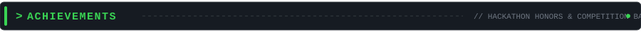

<br /><br />

<!-- HORIZONTAL ROW OF 6 HACKATHON BADGES (CLICK TO ENLARGE) -->
<div align="center">
  <a href="assets/1.png" target="_blank" title="View Full Badge 1">
    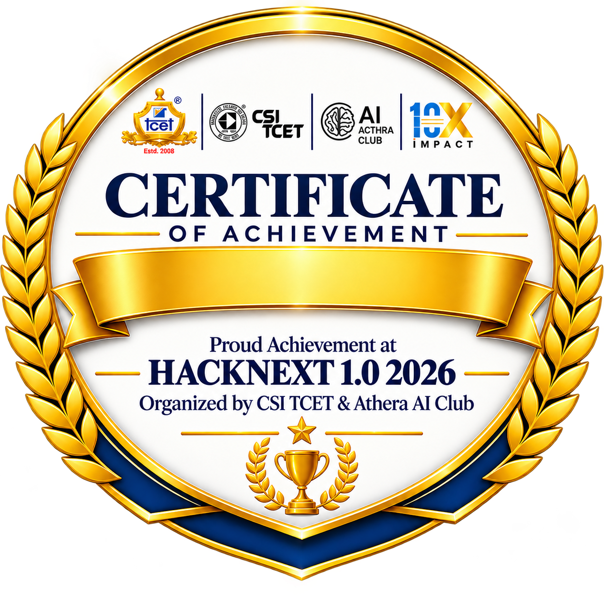
  </a>
  &nbsp;&nbsp;
  <a href="assets/2.png" target="_blank" title="View Full Badge 2">
    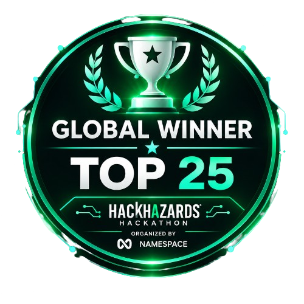
  </a>
  &nbsp;&nbsp;
  <a href="assets/3.png" target="_blank" title="View Full Badge 3">
    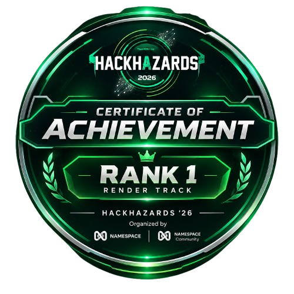
  </a>
  &nbsp;&nbsp;
  <a href="assets/4.png" target="_blank" title="View Full Badge 4">
    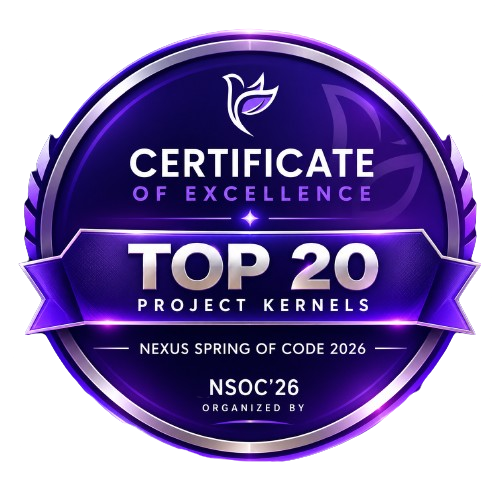
  </a>
  &nbsp;&nbsp;
  <a href="assets/5.png" target="_blank" title="View Full Badge 5">
    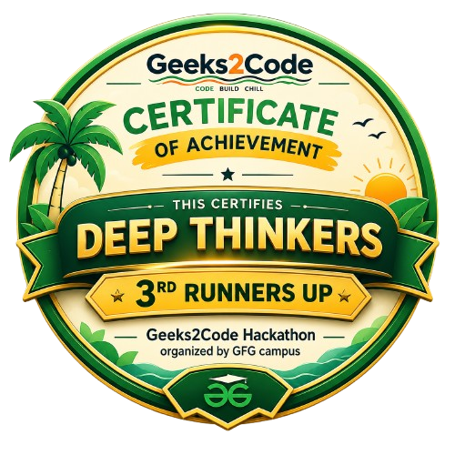
  </a>
  &nbsp;&nbsp;
  <a href="assets/6.png" target="_blank" title="View Full Badge 6">
    
  </a>
</div>

<br />

<!-- VERIFIED MILESTONES & ACHIEVEMENTS LOG -->
<table width="100%">
  <tr>
    <td valign="top">
      <code>&gt; cat verified_achievements.log</code>
      <br /><br />
      &nbsp;&nbsp;🏆 &nbsp;<b>1× Global Hackathon Track Winner</b> &nbsp;—&nbsp; Ranked in Top 25 Globally<br />
      &nbsp;&nbsp;🥇 &nbsp;<b>6× National Hackathon Winner</b> &nbsp;—&nbsp; Recognized at premier nationwide competitive hackathons<br />
      &nbsp;&nbsp;⚡ &nbsp;<b>1× Coding Competition Winner</b> &nbsp;—&nbsp; High-speed algorithmics and problem solving<br />
      &nbsp;&nbsp;🎖️ &nbsp;<b>1× NSoC'26 Winner &amp; Project Admin</b> &nbsp;—&nbsp; Reviewed &amp; managed 250+ PRs across 28 contributors<br />
      &nbsp;&nbsp;🌟 &nbsp;<b>7+ National &amp; State-Level Finalist</b> &nbsp;—&nbsp; Selected among thousands of competing engineering teams<br />
      &nbsp;&nbsp;🐙 &nbsp;<b>GSSoC'26 Open-Source Contributor</b> &nbsp;—&nbsp; 40+ merged pull requests in production open-source ecosystems<br />
      &nbsp;&nbsp;💼 &nbsp;<b>Co-Founder &amp; CTO @ GullyGig</b> &nbsp;—&nbsp; Directing technology, systems architecture, and engineering execution
    </td>
  </tr>
</table>

<br />

<!-- ================================================================= -->
<!--                        5. TECH STACK                              -->
<!-- ================================================================= -->

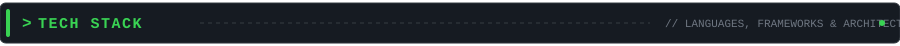

<br /><br />

<table width="100%">
  <tr>
    <td width="28%" valign="top">
      <code>&gt; PROGRAMMING_LANGUAGES</code>
    </td>
    <td width="72%" valign="middle">
      
      
      
      
      
    </td>
  </tr>
  <tr>
    <td width="28%" valign="top">
      <code>&gt; FRONTEND_DEV</code>
    </td>
    <td width="72%" valign="middle">
      
      
      
      
      
    </td>
  </tr>
  <tr>
    <td width="28%" valign="top">
      <code>&gt; BACKEND_&amp;_APP</code>
    </td>
    <td width="72%" valign="middle">
      
      
      
      
      
    </td>
  </tr>
  <tr>
    <td width="28%" valign="top">
      <code>&gt; DATABASES_&amp;_SERVICES</code>
    </td>
    <td width="72%" valign="middle">
      
      
      
      
      
      
    </td>
  </tr>
  <tr>
    <td width="28%" valign="top">
      <code>&gt; CLOUD_&amp;_DEVOPS</code>
    </td>
    <td width="72%" valign="middle">
      
      
      
      
      
      
    </td>
  </tr>
  <tr>
    <td width="28%" valign="top">
      <code>&gt; DATA_SCIENCE_&amp;_AI</code>
    </td>
    <td width="72%" valign="middle">
      
      
      
      
      
    </td>
  </tr>
  <tr>
    <td width="28%" valign="top">
      <code>&gt; HARDWARE_&amp;_IOT</code>
    </td>
    <td width="72%" valign="middle">
      
      
      
    </td>
  </tr>
  <tr>
    <td width="28%" valign="top">
      <code>&gt; WORKFLOW_&amp;_DESIGN</code>
    </td>
    <td width="72%" valign="middle">
      
      
      
      
      
      
    </td>
  </tr>
</table>

<br />

<!-- ================================================================= -->
<!--               6. REAL 3D ISOMETRIC CONTRIBUTION GRAPH             -->
<!-- ================================================================= -->

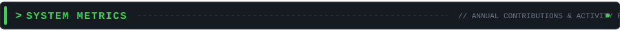

<br /><br />

<!-- 3D ISOMETRIC CONTRIBUTION GRAPH (GENERATED FROM REAL COMMIT ACTIVITY) -->
<div align="center">
  <a href="https://github.com/indresh404">
    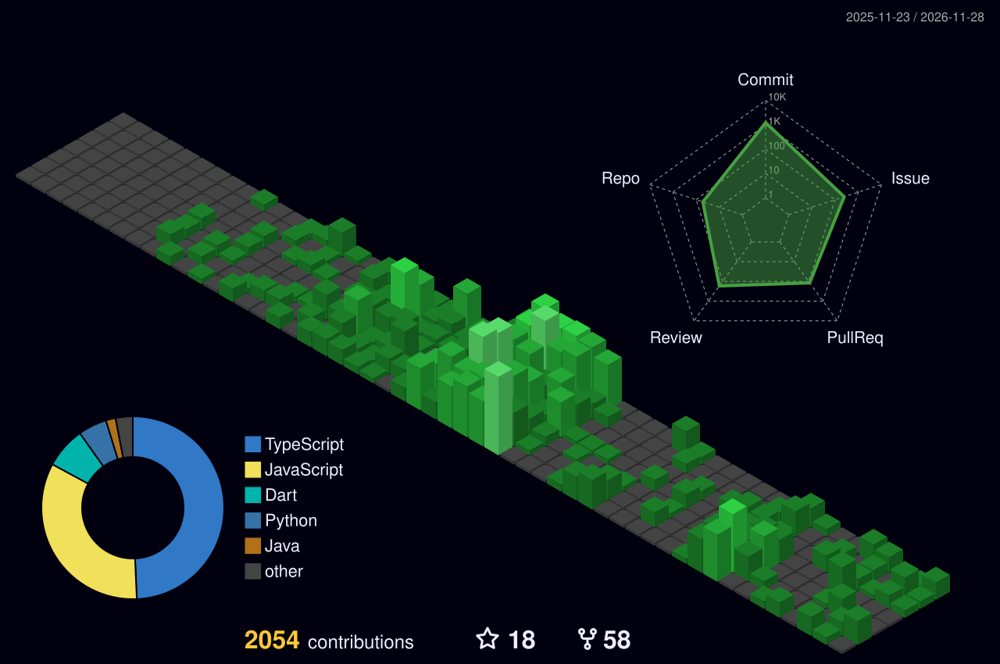
  </a>
</div>

<br />

<!-- ================================================================= -->
<!--                            7. CONNECT                             -->
<!-- ================================================================= -->

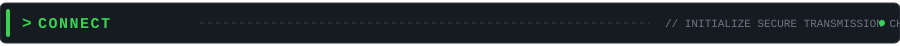

<br /><br />

<table width="100%">
  <tr align="center">
    <td width="25%" align="center">
      <a href="https://github.com/indresh404">
        <br />
        <sub><code>@indresh404</code></sub>
      </a>
    </td>
    <td width="25%" align="center">
      <a href="https://www.linkedin.com/in/indresh-suresh-093646399">
        <br />
        <sub><code>in/indresh-suresh</code></sub>
      </a>
    </td>
    <td width="25%" align="center">
      <a href="mailto:indreshsuresh95@gmail.com">
        <br />
        <sub><code>indreshsuresh95@gmail.com</code></sub>
      </a>
    </td>
    <td width="25%" align="center">
      <a href="https://github.com/indresh404">
        <br />
        <sub><code>indresh404.github.io</code></sub>
      </a>
    </td>
  </tr>
</table>

<br />

<!-- FOOTER ANIMATION -->
<div align="center">
  
</div>

<br />

<!-- TERMINAL PROMPT FOOTER & PROFILE TELEMETRY COUNTER -->
<div align="center">

```bash
indresh@terminal:~$ echo "Always building. Always shipping."
Always building. Always shipping.
[ PROCESS COMPLETED // EXIT CODE 0 ]
```
</div>

<!-- ================================================================= -->
<!--       2. REAL-TIME GITHUB TELEMETRY & LIVE GITHUB STATISTICS       -->
<!-- ================================================================= -->

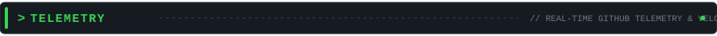

<br /><br />

<!-- REAL-TIME GITHUB TELEMETRY BADGES -->
<div align="center">
  <a href="https://github.com/indresh404">
    
  </a>
  &nbsp;
  <a href="https://github.com/indresh404">
    
  </a>
  &nbsp;
  <a href="https://github.com/indresh404?tab=repositories">
    
  </a>
  &nbsp;
  <a href="https://github.com/indresh404">
    
  </a>
</div>

<br />
